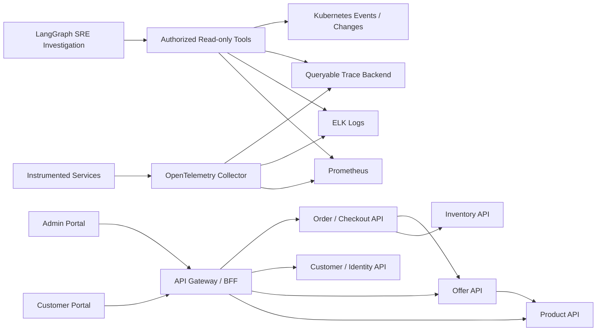

# Architecture — AWS Agentic AI SRE Incident Intelligence

## Architecture decisions
1. **Two independent frontends:** `Portals/agentic-ai-admin` and `Portals/ecommerce-portal` (React + TypeScript recommended). Use a shared design token package only if it materially reduces duplication.
2. **Domain-oriented Java Spring Boot APIs** under `Middleware/`: Product Catalog, Offers, Customers/Identity, Orders/Checkout, Inventory, optional gateway. Each service owns its schema and migrations. Use REST and explicit contracts; asynchronous events only where justified.
3. **SRE agents** under `Middleware/agents`: LangGraph orchestrates bounded, read-only evidence collection, hypothesis testing and structured reporting. Python is acceptable for LangGraph while commerce APIs remain Java 21.
4. **Local platform** under `CICD/Local/`: independent PostgreSQL, Redis, Prometheus and ELK Compose projects. Local scripts start/stop/report them in dependency-aware order. Applications may be added in a separate Compose project later.
5. **AWS target:** EKS for services/agents, RDS PostgreSQL, CloudWatch, OpenTelemetry collector, IAM least privilege. Local ELK/Prometheus are development observability; AWS integrations must be validated separately.

## Logical request and telemetry flows

`Services` represents the instrumented APIs above; diagram arrows indicate logical calls, not direct database access. Traces require an actual queryable backend (e.g. Tempo/Jaeger), not Prometheus alone. Integrate one before claiming distributed trace querying works.

## API contracts (initial)
| Service | API | Auth/notes |
|---|---|---|
| Products | `GET /api/products?query=&sku=&category=&status=&limit=100`, `POST`, `GET /{id}`, `PATCH /{id}`, `DELETE /{id}` | Admin writes; customer-safe reads |
| Offers | `GET /api/offers?query=&productId=&status=&limit=100`, `POST`, `GET /{id}`, `PATCH /{id}`, `DELETE /{id}` | Admin writes; public/customer active offers read; product association required |
| Customers | `POST /api/auth/signup`, `POST /api/auth/signin`, `GET /api/customers`, `GET/PATCH/DELETE /api/customers/{id}` | Secure auth; admin management; self access scoped |
| Orders | `POST /api/checkout`, `GET /api/orders`, `GET /api/orders/{id}`, `PATCH /api/orders/{id}`, `DELETE /api/orders/{id}` | Checkout is customer-only create path; admin cannot POST order; cancellation/soft-delete preferred |
| Inventory | `GET /api/inventory/{productId}`, internal reserve/release endpoints | Internal service authorization |

API details are **proposed contracts** until implemented and verified. All list endpoints filter server-side then sort `createdAt DESC, id DESC` and limit to 100. Frontend paginates the returned 100 client-side. For orders: `createdFrom` inclusive and `createdToExclusive` exclusive in UTC ISO 8601; UI translates date selection using a documented timezone. Validate limits, fields, ownership and allowed status transitions server-side.

## Checkout correctness
Validate authenticated identity, offer active/valid, product status, quantity and inventory; calculate prices on server; snapshot item details; use idempotency key and a transactional state machine. For multi-service coordination, define compensation/retry behavior; do not claim exactly-once execution. Payment is a labeled sandbox simulation unless a compliant payment provider is separately integrated. Emit trace correlation IDs across all service hops.

## Observability and fault injection
- OpenTelemetry Java instrumentation: HTTP inbound/outbound, JDBC, custom HikariCP pool gauges and meaningful business spans.
- Logs: structured JSON with trace ID, span ID, service name, error code and safe contextual metadata. Never log credentials, session tokens or sensitive customer details.
- Metrics: request rate, error rate, p95/p99 latency, JVM, CPU, HikariCP active/idle/pending, downstream latency and checkout failures.
- Controlled faults: connection pool reduced under load; Inventory response delay; invalid service endpoint; business-level failure with healthy pods.
- Every fault needs injection, ground truth, evidence, rollback and baseline recovery validation.

## AI investigation contract
Inputs: incident ID, affected service(s), time window and permitted tool scope. Tools: `query_logs`, `query_metrics`, `query_traces`, `get_kubernetes_events`, `get_deployment_history`. Outputs: evidence IDs/links, competing hypotheses, supporting/refuting signals, confidence with limitations, proposed diagnosis and non-executing remediation advice. Apply tool budgets, timeouts, least privilege, audit logs, PII redaction and prompt-injection resistance. Human approval is mandatory for mutations.

## Local developer operations
`npm run local:containers:all:start`, `npm run local:containers:all:status`, `npm run local:containers:all:stop`. Each stack lives in `CICD/Local/<Name>/docker-compose.yaml`; scripts rely on Docker Compose v2 and an optional `CICD/Local/.env` (copy from `.env.example`). Default ports are for local development and may conflict with other processes. Local container startup does **not** mean application APIs or portals are implemented or running.

## Delivery gates
1. Compose validation and healthy local dependencies.
2. Working product/offer/customer/order/inventory APIs with migrations and tests.
3. Both portals integrated with real APIs and correct authorization.
4. Traces/logs/metrics verified from real checkout traffic.
5. Fault injection + diagnosis and measured model comparisons.
6. AWS deployment and cleanup tested separately, with cost controls.
