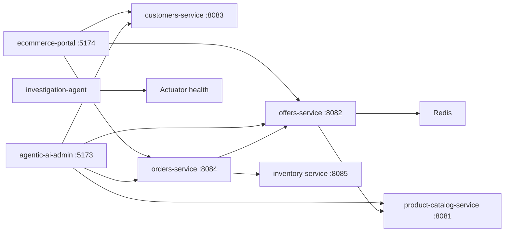

# Architecture

This file records how Heddle is structured and which contracts exist today. Product behavior is in [DESIGN.md](DESIGN.md). Agent working rules, the incident report contract, and experiments INC-001 through INC-004 are in [CLAUDE.md](CLAUDE.md).

## In the tree

1. **Two React and TypeScript portals** call the Java services directly. `Portals/agentic-ai-admin` uses Vite on port 5173. `Portals/ecommerce-portal` uses Vite on port 5174. There is no API gateway or BFF.
2. **Five Java 21 Spring Boot services** live under `Middleware/`. Each one owns a PostgreSQL database, uses HikariCP (`HIKARI_MAX_POOL`, default 10), and updates schema with Hibernate `ddl-auto: update`. There are no Flyway or Liquibase migrations in the tree.
3. **The investigation agent** is `Middleware/investigation-agent` (FastAPI, LangGraph, Uvicorn). `Middleware/agents` is not a folder. Use that name only if a future task creates it, and label the path as future.
4. **Local dependencies** are independent Compose projects in `CICD/Local/Postgres`, `Redis`, `Prometheus`, `ELK`, and `Jaeger`. Root npm scripts call `docker-all-up.sh`, `docker-all-down.sh`, and `docker-all-status.sh`. `local:middleware:all:*` and `local:portals:all:*` start the Java services and the two Vite apps. `local:middleware-portals:all:*` calls those scripts in order.
5. **AWS** (EKS, RDS, CloudWatch, least-privilege IAM) is a later deployment target. Nothing in this repository provisions it.

| Service | Port | Database |
|---|---|---|
| `product-catalog-service` | 8081 | `product_catalog` |
| `offers-service` | 8082 | `offers` |
| `customers-service` | 8083 | `customers` |
| `orders-service` | 8084 | `orders` |
| `inventory-service` | 8085 | `inventory` |

Postgres 16 listens on `localhost:5432`. The init script creates `offers`, `customers`, `orders`, and `inventory`; the Compose `POSTGRES_DB` is `product_catalog`. Redis 7.4 listens on `localhost:6379`. Offers uses it as a 60-second cache of catalog products (`catalog:product:{id}`). Redis is not a system of record. Java packages are `com.larkspur`.

Local database and JWT defaults are in the Compose files and `application.yml`. Do not copy them into new documents or production configuration. A root `.env.example` is not in the tree.

## Request flow today



Purchase is the only order create path. `POST /api/orders` requires `Authorization: Bearer <token>`. The token is a JWT from `POST /api/auth/signup` or `POST /api/auth/signin`. The body is `{ "offerId" }`. Orders loads the offer, rejects a non-`ACTIVE` offer or an offer with no products, copies customer identity from the token, sets `totalAmount` from `offerPrice`, snapshots each product as a line with quantity 1, and saves the row with an `HD-` order number and status `PLACED`. It then calls `POST /api/reservations`. If reservation fails, it deletes that new row and returns an error. A second purchase creates a second order. There is no idempotency key and no payment call.

Desk writes do not send a bearer token. `GET /api/orders` is also unauthenticated and returns the latest 100 orders. `GET /api/orders/mine` is the shopper's scoped read.

## HTTP contracts today

List routes below return the latest 100 rows and ignore filter query parameters. `/api/offers/active` is the exception inside that limit: from those latest 100 it keeps `ACTIVE` offers whose `startsOn` is null or on or before today UTC, and whose `endsOn` is null or on or after today UTC. Updates use `PUT`. Deletes call `deleteById`.

| Service | Routes |
|---|---|
| Catalog | `GET /api/products`, `GET /api/products/lookup?ids=`, `GET /api/products/{id}`, `POST /api/products`, `PUT /api/products/{id}`, `DELETE /api/products/{id}` |
| Offers | `GET /api/offers`, `GET /api/offers/active`, `GET /api/offers/{id}`, `POST /api/offers`, `PUT /api/offers/{id}`, `DELETE /api/offers/{id}` |
| Customers | `GET /api/customers`, `GET /api/customers/{id}`, `POST /api/customers`, `PUT /api/customers/{id}`, `DELETE /api/customers/{id}`, `POST /api/auth/signup`, `POST /api/auth/signin`, `GET /api/auth/me` |
| Orders | `GET /api/orders`, `GET /api/orders/mine`, `GET /api/orders/{id}`, `POST /api/orders`, `PUT /api/orders/{id}`, `DELETE /api/orders/{id}` |
| Inventory | `GET /api/stock`, `PUT /api/stock/{sku}`, `POST /api/reservations` |

Offer writes require a non-empty `productIds` list. The service checks those ids with the catalog and rejects duplicates. Responses include `productIds` and product summaries. Sort for catalog, offers, and customers is `createdAt` descending. Orders sort by `placedAt` descending. Stock sorts by `updatedAt` descending and is keyed by SKU.

`PUT /api/orders/{id}` accepts `status` and `note`. `POST /api/reservations` accepts `orderRef` and `lines` of `{ sku, qty }`. Inventory sleeps for `FAULT_DELAY_MS` milliseconds before reserving when that value is greater than zero. The default is `0`.

Passwords are bcrypt hashed. `GET /api/auth/me` requires the bearer token.

The investigation agent exposes `GET /health`, `GET /api/services`, and `POST /api/investigations` with `{ "service" }`. The graph probes `GET /actuator/health` on the five services and returns `service`, `signals`, `facts`, `hypotheses`, and `recommendations`. The module does not pin a listen port. It does not mutate services.

## Target contract

Still to build. Do not document these as present:

- An API gateway in front of the five services.
- Server-side filters applied before the 100-row limit, then browser pagination of that bounded result. Order ranges use `placedAt`, inclusive start, exclusive end, in a documented timezone. DESIGN.md states the current inclusive local-day behavior.
- Order cancellation that retains the row and records an audit trail. Keep using `PUT` for updates unless a task changes the verb.
- An idempotency key on purchase, and a payment step labeled as a simulation until a real provider is approved.
- Authorization on desk writes and on `GET /api/orders`, so a shopper token cannot read another customer's orders.
- Versioned migrations in place of `ddl-auto: update`.
- Investigation queries against the trace store. Services can export OTLP when `observability.traces.exporter=otlp`. Prometheus remains the metrics store.
- Read-only investigation tools `query_logs`, `query_metrics`, `query_traces`, `get_kubernetes_events`, and `get_deployment_history`, returning the report contract in CLAUDE.md.
- A root `.env.example` that lists local ports and placeholders. The Compose files remain the source for the ports below until that file exists.
- Amazon EKS, RDS, CloudWatch, and least-privilege IAM, validated separately from local Compose.

## Observability today

Each Java service exposes Actuator `health`, `info`, `prometheus`, and `metrics`, and depends on Micrometer. `CICD/Local/Prometheus/prometheus.yml` scrapes `host.docker.internal:8081` through `8085` at `/actuator/prometheus`.

Exporter choice is `observability.metrics.exporter`, `observability.logs.exporter`, and `observability.traces.exporter`, overridable with `OBSERVABILITY_METRICS_EXPORTER`, `OBSERVABILITY_LOGS_EXPORTER`, and `OBSERVABILITY_TRACES_EXPORTER`.

| Signal | Wired values | Reserved, startup fails if selected |
|---|---|---|
| Metrics | `prometheus`, `none` | `cloudwatch`, `azure-monitor` |
| Logs | `console`, `logstash` | `cloudwatch`, `azure-monitor` |
| Traces | `none`, `otlp` | `xray`, `azure-monitor` |

`logstash` activates the `elk` Spring profile. Logback then sends JSON to Logstash TCP `localhost:5044`. `console` does not. The ELK Compose project publishes Elasticsearch on `localhost:9200` and Kibana on `localhost:5601`.

`otlp` turns on Micrometer tracing with the OpenTelemetry bridge and posts spans to `observability.traces.otlp-endpoint`, default `http://127.0.0.1:4318/v1/traces`. Local Jaeger all-in-one listens there and serves its UI on `http://localhost:16686`. The same OTLP endpoint is the switch for a later collector. `none` leaves tracing off. `local:middleware:all:start` selects `logstash` when port 5044 is open and `otlp` when port 4318 is open, unless those variables are already set.

The investigation agent does not query Prometheus, Elasticsearch, or Jaeger.

## Local operations

```bash
npm run local:containers:all:start
npm run local:containers:all:status
npm run local:containers:all:stop
```

`docker-all-up.sh` creates the external network `sre-incident-net` when it is missing, then starts Postgres, Redis, Prometheus, ELK, and Jaeger with Docker Compose v2. `docker-all-up.sh` and `docker-all-down.sh` use `set -euo pipefail` and fail if Docker or Compose is missing. `docker-all-status.sh` prints each stack and continues when a stack is down. Starting the containers does not start the Java processes, the agent, or the portals.

Default published ports: Postgres `5432`, Redis `6379`, Prometheus `9090`, Elasticsearch `9200`, Kibana `5601`, Logstash TCP `5044`, Jaeger UI `16686`, Jaeger OTLP `4318`.

## Delivery gaps

The commerce path and the health-only agent are in the tree. Still open: server-side filtered lists, desk and order-list authorization, order soft cancellation, idempotent purchase, a labeled payment simulation, investigation tools beyond health, k6, and any AWS or Azure deployment. Claim a gap closed only after the code and a run show it.
