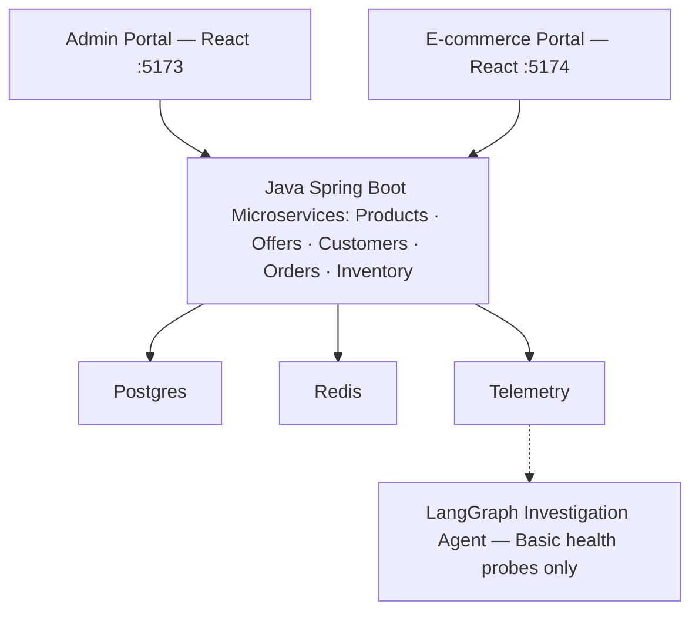

# GitHub Repository Review — AWS Agentic AI SRE Incident Intelligence

**Reviewed October 31, 2026 · `main` branch · Commit `504a667`**

I've inspected the repository through your GitHub connection and compared the implementation against our discussions about AWS, Java microservices, the administration and customer portals, observability, and AI-based incident investigation.

**My assessment: You have made substantial progress on the e-commerce application and local infrastructure. However, the core Site Reliability Engineering (SRE) incident intelligence solution is still at an early implementation stage.**

> **Overall project stage: Local application foundation — Not yet validated end-to-end.**
>
> The commerce code, portal screens, orchestration scripts, and observability configurations exist. Real incident diagnosis, model comparisons, and AWS deployment remain major work items.
>
> **5** Java microservices · **2** React portals · **5** local infrastructure stacks

## 1. Where we stand against our agreed requirements

| Requirement | Status | What I found |
|---|---|---|
| `README.md`, `CLAUDE.md`, `DESIGN.md`, `ARCHITECTURE.md` | Present | All four documents exist |
| Root `package.json` | Present | Start, stop, status scripts |
| PostgreSQL, Redis, Prometheus, ELK | Configured | Separate Docker Compose stacks |
| Jaeger distributed tracing | Configured | Additional local trace backend |
| Java Spring Boot microservices | Implemented in code | Five service modules |
| Admin portal CRUD | Implemented in code | Products, offers, customers, orders |
| Customer portal | Implemented in code | Signup, signin, offer browsing, purchase, order history |
| Latest 100 + search + pagination | Partial | Browser filtering happens after the latest 100 are fetched |
| Professional light-themed UI | Implemented in CSS | Ivory, spruce, coral, teal |
| LangGraph investigation service | Basic implementation | Health probes and rule-based assessment |
| Evidence-based root-cause analysis | Not implemented | No log/metric/trace correlation in the agent |
| LLM reasoning and model comparison | Not implemented | No LLM provider integration in the current agent |
| AWS EKS / RDS deployment | Not implemented | No AWS provisioning or deployment configuration |
| Automated incident experiments | Not found | No implemented fault-injection test suite |

These statuses describe the committed code and configurations, not successful execution on your machine.

## 2. Your actual architecture today



*Logical view of the committed local application. The agent presently checks service health; it does not yet correlate observability evidence.*

The Java services use ports 8081–8085. The admin portal runs on 5173, the storefront on 5174, and the investigation service is configured to run on 8090.

The application is presently a **local-first microservices system**, not an AWS-deployed system.

## 3. Admin portal — most of your functional requirements are implemented

Your `agentic-ai-admin` is a React and TypeScript application with real API integration.

| Requirement | Code review |
|---|---|
| Product Catalog CRUD | Present |
| Offers CRUD | Present |
| Offers mapped to products | Present |
| Customers CRUD | Present |
| Orders Read/Update/Delete | Present |
| No order creation in admin | Correct |
| Latest 100 records | Present |
| Client-side pagination | Present |
| Search fields | Present |
| Orders date range | Present |
| Responsive styling | Present |

The orders screen includes customer name, email, offer, status, and placed-from/placed-to filters.

**One important mismatch:** You originally requested search criteria applied before returning the latest 100 results, followed by client-side pagination. Currently, the API fetches the latest 100 first, then the browser filters those records. A matching record older than the latest 100 will not appear in search results.

## 4. E-commerce portal — the main purchase flow is in place

The customer portal includes routes for offers, offer details, signup, signin, and order history.

The implemented purchase flow is:

1. Customer registers or signs in
2. Customer searches available offers
3. Customer opens offer and purchases
4. Orders Service validates the offer
5. Orders Service creates order
6. Inventory Service reserves products
7. Customer views order history

The backend derives the customer identity from the authentication token and determines the purchase amount from the offer. That's a sound design direction.

There are still important issues:

- A repeated purchase request can create duplicate orders because idempotency is not implemented.
- There is no payment processing or simulated payment workflow.
- A failed inventory reservation causes the new order to be deleted rather than following a durable, recoverable order workflow.
- Order cancellation currently removes records rather than preserving an auditable order history.

For a local demonstration, the workflow is meaningful. For enterprise-grade order processing, these issues need attention.

## 5. Local infrastructure — very close to the layout you requested

Your `CICD/Local` directory now contains the exact independent stacks we discussed, plus Jaeger.

The root commands are correctly present:

```bash
npm run local:containers:all:start
npm run local:containers:all:status
npm run local:containers:all:stop

npm run local:middleware:all:start
npm run local:middleware:all:status
npm run local:middleware:all:stop

npm run local:portals:all:start
npm run local:portals:all:status
npm run local:portals:all:stop
```

There are also commands for starting and stopping middleware and portals together.

Your microservices expose Actuator metrics for Prometheus, can send application logs to Logstash, and have OTLP trace exporter configuration for Jaeger.

**What has not been verified:** Whether all Docker containers become healthy, whether the Java services compile and start together, and whether metrics, logs, and traces actually arrive in the corresponding dashboards.

Those require execution tests, not just source inspection.

## 6. The critical gap — Agentic AI for Site Reliability Engineering

This was the original reason we started the repository: to test whether an advanced LLM could investigate a real microservices incident rather than simply make impressive claims in a YouTube Short.

I inspected `Middleware/investigation-agent/app/graph.py`.

It has a working-looking LangGraph structure:

`triage → signals → assess → recommend`

However, the current investigation consists primarily of querying `/actuator/health` for the five services.

| Capability | Status |
|---|---|
| Basic health endpoint investigation | Implemented in code |
| Logs, metrics, and traces investigation | Not implemented |
| LLM-powered root-cause assessment | Not implemented |
| Real AWS incident investigation | Not implemented |

The graph currently applies deterministic rules to service health signals. It does not call an LLM, query Prometheus or Jaeger, examine logs, correlate deployment changes, or validate root causes.

This is not a criticism of the initial implementation. It is a useful first orchestration step. But it cannot yet demonstrate the technical claims we intend to make in Short 1.

## 7. Critical engineering findings

These are the most important issues I would address before calling the application enterprise-ready.

### High priority — Administration APIs are not protected

The admin portal sends no authentication token for product, offer, customer, or order management. The current controllers also expose these operations without role-based authorization.

That means someone able to reach those endpoints could potentially read customer information or modify business records.

This is acceptable only inside a tightly isolated development environment, not on an exposed AWS deployment.

### High priority — Order and inventory consistency

The order service saves an order, invokes inventory reservation, and deletes the order on a reported reservation failure.

These are separate databases and separate transactions. A timeout can occur after inventory successfully reserves stock, leaving inventory and order records inconsistent.

This requires idempotency, durable transaction state, and a recovery or compensation strategy.

### High priority — Secrets and customer session handling

Local database passwords and JWT secrets are committed in application configuration. The shopper session is stored in browser `localStorage`.

Before AWS deployment, secrets need external management, and authentication/session controls need hardening. The current configuration must remain local-only.

### High priority — Testing and CI/CD

I found a unit test for the shared observability configuration, but no comprehensive service integration tests, complete purchase-flow tests, fault-injection suite, or GitHub Actions workflow.

GitHub currently reports zero workflow runs. We therefore have no CI evidence that the complete application builds and passes tests.

One additional security issue: `GET /api/orders/{id}` is not scoped to the authenticated customer. Even though the storefront uses `/api/orders/mine`, direct object access still needs authorization.

## 8. How close are we to validating YouTube Short 1?

Remember the original claim:

> GPT-6 Astra can help Site Reliability Engineers investigate logs, metrics, traces, and deployment changes to identify potential root causes.

Here is what the actual repository can currently demonstrate.

| YouTube Short claim | Can we prove it today? |
|---|---|
| Five Java microservices provide a realistic system under test | Code exists; runtime validation pending |
| Monitoring infrastructure is configured | Yes, configuration exists |
| Distributed tracing can be exported | Configured; ingestion unverified |
| AI can check microservice health | Implemented; execution unverified |
| AI can analyze application logs | Not yet |
| AI can correlate metrics and distributed traces | Not yet |
| AI can compare recent deployment changes | Not yet |
| AI can establish the root cause of an injected failure | Not yet |
| Astra performs better than another GPT model | No comparative evidence |
| AI reduces incident investigation time | Not measured |

**We are not yet ready to use this repository as proof of the Astra claims in Short 1.** The good news is that the application and telemetry foundation needed for those experiments is taking shape.

## 9. What I would build next, in priority order

### 01 — Establish a working application baseline

Run the five Java services and both portals, test the complete signup-to-purchase flow, verify PostgreSQL and Redis integration, and capture real build and test results.

*Exit criterion: Repeatable local startup and successful end-to-end commerce workflow.*

### 02 — Verify observability end-to-end

Generate traffic and confirm API latency metrics in Prometheus, application errors in Kibana, and Order-to-Inventory traces in Jaeger.

*Exit criterion: A real request can be followed across services using its trace ID.*

### 03 — Implement Incident INC-001: Connection Pool Exhaustion

Add repeatable k6 load, introduce a controlled HikariCP misconfiguration, and observe connection acquisition waits and API degradation.

*Exit criterion: Reproducible failure, captured evidence, and verified recovery.*

### 04 — Upgrade LangGraph to evidence-based incident investigation

Add read-only Prometheus, Elasticsearch, Jaeger, and deployment-history tools. Introduce configurable LLM reasoning and structured, evidence-cited investigation reports.

*Exit criterion: The agent identifies the injected failure without being told its cause.*

### 05 — Add comparative model evaluation and AWS deployment

Compare supported models on identical incidents, record accuracy/latency/cost, and deploy the validated environment to EKS using controlled infrastructure-as-code.

*Exit criterion: Reproducible model comparisons and separately verified AWS operation.*

Security hardening, order consistency, and automated tests should proceed alongside these phases, before exposing the system outside the local development environment.

## Final assessment

The project now has two distinct parts:

**Heddle Commerce Application:** A substantial initial implementation exists. Five microservices, two portals, real CRUD endpoints, purchase logic, local infrastructure scripts, and observability configurations are committed.

**AWS Agentic AI SRE Incident Intelligence:** The documentation and initial LangGraph orchestration exist, but the essential evidence-collection, LLM reasoning, controlled incident testing, and model evaluation capabilities remain unfinished.

My recommendation is **not to add more portals or business features right now**. Establish the current commerce application as a reliable system under test, then build the incident intelligence capability that motivated this project.

The next meaningful milestone is:

**Generate a real Order Service incident, observe it in Prometheus/ELK/Jaeger, and have LangGraph determine the cause using actual evidence.**

Once we can reproduce that result and compare it across models, you'll have a credible hands-on foundation for the Site Reliability Engineering YouTube Short.

*Review scope: GitHub `main` source and configuration inspection. I did not execute Maven, npm, Docker, browser tests, or AWS deployments, so runtime correctness and performance remain unverified. No repository files were changed during the review.*

[View reviewed GitHub repository](https://github.com/javakishore-veleti/AWS-Agentic-AI-SRE-Incident-Intelligence)
