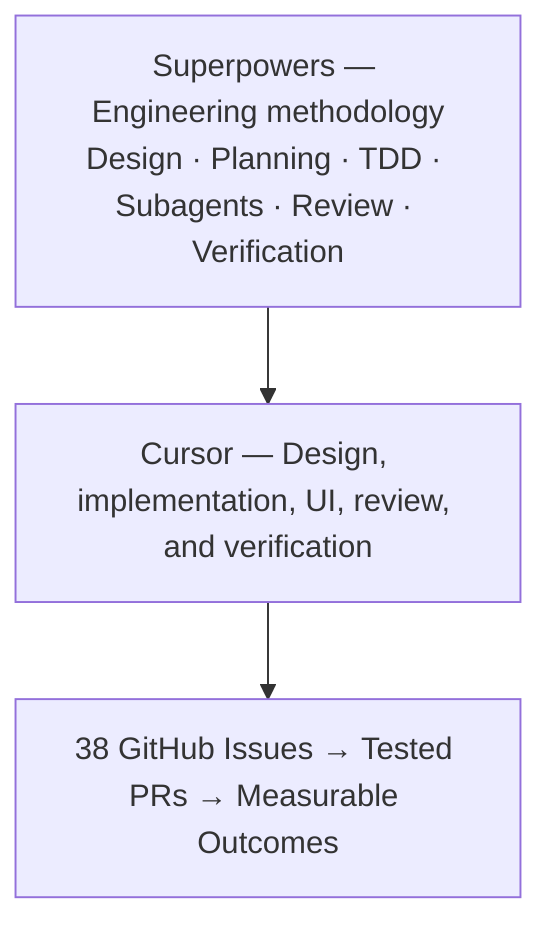

# Superpowers Adoption — AWS Agentic AI SRE Incident Intelligence

> **Status:** Adoption and mastery plan. Descriptions of planned capabilities are not claims of completed implementation.

That changes my recommendation significantly! If your goal is to **master Superpowers and demonstrate that expertise on your resume as a Chief Architect**, you should use Superpowers as the primary engineering methodology across the entire GitHub project—not merely as an optional tool.

Your `AWS-Agentic-AI-SRE-Incident-Intelligence` repository is an excellent opportunity to demonstrate this through actual engineering artifacts.

## 1. Revised strategy

Use Superpowers inside Cursor for the whole lifecycle. Claude Code and Codex are later options. They are not part of the current execution path.

## 2. Superpowers mastery plan

I recommend a six-week learning plan, using your actual GitHub issues as exercises.

| Week | Superpowers capabilities | Hands-on GitHub issues |
|---|---|---|
| 1 | Brainstorming, writing plans, Git worktrees | APP-001, APP-002 |
| 2 | TDD, systematic debugging, verification | REL-001, SEC-002 |
| 3 | Subagent-driven development, code review | OBS-001, OBS-002, OBS-003 |
| 4 | Complex planning and multi-agent coordination | AI-005, AI-001, AI-002 |
| 5 | Failure analysis and evidence-based testing | SRE-001, AI-006, AI-003 |
| 6 | Infrastructure planning, risk reviews, lifecycle verification | AWS-001, AWS-009, AWS-010, AWS-011 |

*These are learning targets, not a promise that all the listed production-grade issues can be completed within six weeks.*

### What mastery should look like

For each issue, capture evidence that you followed the methodology:

- An approved design or documented decision.
- A task-level implementation plan.
- A dedicated Git branch or worktree.
- Tests demonstrating red-green-refactor where applicable.
- Implementation commits and code review findings.
- Verified acceptance criteria and a linked pull request.

After completing several issues, you should be able to explain **why** you used particular Superpowers skills, where they improved the engineering process, and where they added unnecessary overhead.

## 3. Demonstrate architectural leadership, not just tool usage

For a Chief Architect resume, the most valuable accomplishment is not installing Superpowers. It is showing how you used a structured AI-assisted engineering methodology to deliver a complex system.

Track these metrics throughout the project:

| Metric | What it demonstrates |
|---|---|
| Issues completed using Superpowers | Adoption across engineering workstreams |
| PRs with documented design and test evidence | Engineering governance |
| Automated test pass rate | Delivery quality |
| Critical review findings resolved | Review effectiveness |
| Incident root-cause accuracy | Agentic AI effectiveness |
| AWS provisioning and teardown success rate | Infrastructure reproducibility |
| Engineering cycle time | Delivery efficiency |

Avoid claiming that Superpowers improved productivity by a particular percentage unless you establish a baseline and measure it.

## 4. Resume positioning

Once you've implemented and verified meaningful portions of the repository, you could use the following under a **Selected Architecture Projects** section.

### Agentic AI SRE Incident Intelligence — Chief Architect / Independent Engineering Project

**Technologies:** Superpowers, Cursor, LangGraph, Java 21, Spring Boot, Python, React, AWS EKS, CloudFormation, GitHub Actions, Prometheus, Elasticsearch, Jaeger.

- Architected an AI-driven SRE incident intelligence platform integrating microservices, distributed observability, LangGraph-based investigation workflows, and evidence-backed root-cause analysis.
- Applied the **Superpowers AI-assisted software engineering methodology** across architecture design, implementation planning, test-driven development, subagent orchestration, code review, and verification.
- Designed reusable engineering skills and GitHub issue-driven workflows to standardize implementation across application services, AI agents, observability, and AWS infrastructure.
- Established reproducible incident-injection and model-evaluation scenarios to assess root-cause correctness, evidence quality, latency, and operational reliability.

**These bullets describe the intended completed project. Don't use them as completed accomplishments yet** until the corresponding capabilities have been implemented and validated. You can currently describe the architecture and planned methodology as an ongoing independent project.

## 5. What I recommend doing now

Start with **APP-001 in Cursor Agent + Superpowers**. Let Superpowers handle brainstorming, planning, worktree setup, implementation, tests, review, and verification.

Stay in Cursor for the issues that follow, including Java services, LangGraph, telemetry, incident work, AWS, and the portals. Claude Code is out of this phase.

**Your ultimate resume story should be:** *I architected and delivered an agentic AI SRE platform using a repeatable, skills-driven AI engineering methodology, with test-first implementation, independent reviews, measurable incident evaluations, and controlled AWS infrastructure lifecycle management.*

That is substantially stronger for a Chief Architect role than simply listing “Superpowers” under AI tools.

---

**Execution companion:** [SUPERPOWERS_GitIssues_OperatingModel.md](SUPERPOWERS_GitIssues_OperatingModel.md).
